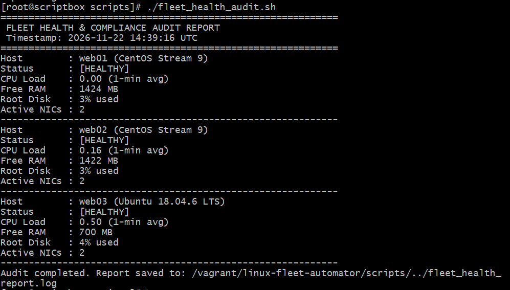
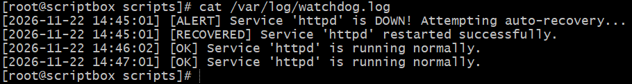

# Multi-OS Linux Fleet Provisioning, Self-Healing & Health Audit Framework

An end-to-end, modular **Bash Scripting** automation framework engineered to eliminate repetitive manual system administration across heterogeneous Linux server fleets (**CentOS Stream / RHEL** and **Ubuntu**) using passwordless SSH/SCP, Bash arrays, and Cron scheduling.

## Repository Architecture

```text
linux-fleet-automator/
├── Vagrantfile                         # Multi-OS Lab (scriptbox, web01, web02, web03)
├── inventory/
│   └── hosts.txt                       # Target server inventory
├── scripts/
│   ├── deploy_fleet.sh                 # Master orchestrator (SCP + remote SSH execution)
│   ├── provision_node.sh               # Multi-OS web server provisioning (yum vs apt)
│   ├── fleet_health_audit.sh           # Remote CPU, RAM, Disk & NIC health auditor
│   └── service_watchdog.sh             # Self-healing service monitor (Cron daemon)
├── assets/
│   ├── fleet_health_audit_output.png   # Multi-node health audit output proof
│   └── watchdog_auto_recovery.png      # Automated service recovery log proof
└── README.md
```

## Core Automation Modules & Engineering Practices

- **Defensive & Modular Scripting**: Built with `set -euo pipefail`, modular functions, `local` variable scoping, and defensive file checks (`if [ ! -f ... ]`).
- **Safe Multi-Host Iteration**: Loads target servers from `inventory/hosts.txt` into Bash arrays via `mapfile -t` (filtering out comments) and iterates with `for` loops to prevent the `while`-loop SSH stdin exhaustion bug.
- **Cross-OS Detection (`provision_node.sh`)**: Dynamically identifies RPM-based (`yum` / `httpd`) vs. Debian-based (`apt` / `apache2`) distributions and automates package setup and web artifact deployment.
- **Remote Fleet Health Auditing (`fleet_health_audit.sh`)**: Collects 1-minute CPU load average, free RAM (MB), root partition disk usage (`/`), and active non-loopback network interfaces across all nodes into timestamped reports with threshold alerts (`[HEALTHY]` / `[WARNING]` / `[CRITICAL]`).
- **Self-Healing Service Watchdog (`service_watchdog.sh`)**: Scheduled via cron (`* * * * *`) to detect stopped services, trigger automatic restarts, and log recovery timestamps to `/var/log/watchdog.log`.

## Execution Proof & Live Outputs

### 1. Multi-OS Fleet Health & Compliance Audit (`fleet_health_audit.sh`)
Audits `web01` (CentOS Stream 9), `web02` (CentOS Stream 9), and `web03` (Ubuntu 18.04.6 LTS) concurrently from the control node:



### 2. Autonomous Service Recovery (`service_watchdog.sh` + Cron)
Detects service downtime (`[ALERT]`), automatically restarts `httpd` (`[RECOVERED]`), and verifies normal operation (`[OK]`):



## Quick Usage

```bash
# 1. Run Remote Fleet Health Audit across all nodes
./scripts/fleet_health_audit.sh

# 2. Deploy & provision web servers across CentOS and Ubuntu nodes
./scripts/deploy_fleet.sh

# 3. Schedule self-healing watchdog via crontab (runs every minute)
* * * * * /vagrant/linux-fleet-automator/scripts/service_watchdog.sh httpd
```
